# Arquitectura y diseño de TelcoCore MVNO

Este documento explica **cómo está construido** el sistema y **por qué**. Cada diagrama se entrega de dos formas:
como **imagen** (carpeta [`diagramas/`](diagramas), lista para insertar en un informe o en las láminas) y como
**texto Mermaid** (se dibuja solo en GitHub y se puede editar en <https://mermaid.live>).

> **Qué hace el sistema.** Recibe archivos de registros de detalle de llamada (CDR) de un operador móvil virtual,
> valida cada registro, lo **tarifica** según el plan del suscriptor (prepago, postpago con incluidos o datos por
> tramos), manda a **cuarentena** los inválidos y calcula la **factura mensual**. Todo se expone por una API REST.

## Índice
1. [Arquitectura por capas](#1-arquitectura-por-capas)
2. [Jerarquía de CDR y lectura de lotes](#2-jerarquía-de-cdr-y-lectura-de-lotes)
3. [Estrategias de tarificación](#3-estrategias-de-tarificación)
4. [Persistencia: Repository y Unidad de Trabajo](#4-persistencia-repository-y-unidad-de-trabajo)
5. [Errores del dominio](#5-errores-del-dominio)
6. [Secuencia: procesar un lote](#6-secuencia-procesar-un-lote)
7. [Secuencia: consultar una factura](#7-secuencia-consultar-una-factura)
8. [Modelo de datos](#8-modelo-de-datos)
9. [Patrones de diseño y principios SOLID](#9-patrones-de-diseño-y-principios-solid)
10. [Decisiones de diseño y sus compromisos](#10-decisiones-de-diseño-y-sus-compromisos)
11. [Limitaciones conocidas y trabajo futuro](#11-limitaciones-conocidas-y-trabajo-futuro)

---

## 1. Arquitectura por capas

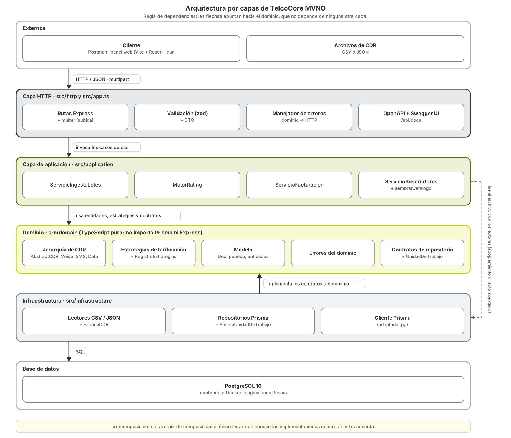

Ver el código Mermaid (editable; GitHub lo dibuja solo)

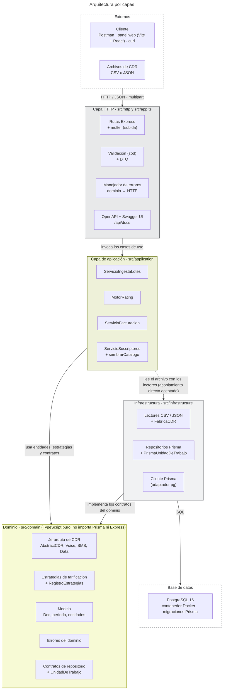

**Regla de dependencias:** todas las flechas apuntan hacia el **dominio**, que es TypeScript puro y no importa Prisma
ni Express. Esa regla no es solo una convención: la verifican ESLint (`no-restricted-imports`) y una prueba
automática ([`test/unit/arquitectura.test.ts`](../test/unit/arquitectura.test.ts)).

| Capa | Carpeta | Responsabilidad |
| --- | --- | --- |
| HTTP | `src/http`, `src/app.ts` | Traducir HTTP a casos de uso: rutas, validación (zod), errores uniformes, OpenAPI |
| Aplicación | `src/application` | Casos de uso: ingesta de lotes, rating, facturación, suscriptores |
| Dominio | `src/domain` | Reglas del negocio: CDR, estrategias, errores y **contratos** (interfaces) de repositorio |
| Infraestructura | `src/infrastructure` | Detalles técnicos: lectores CSV/JSON y repositorios Prisma |

`src/composicion.ts` es la **raíz de composición**: el único archivo que conoce las implementaciones concretas y las
conecta. Gracias a eso, las pruebas de la API usan servicios simulados sin necesitar base de datos.

## 2. Jerarquía de CDR y lectura de lotes

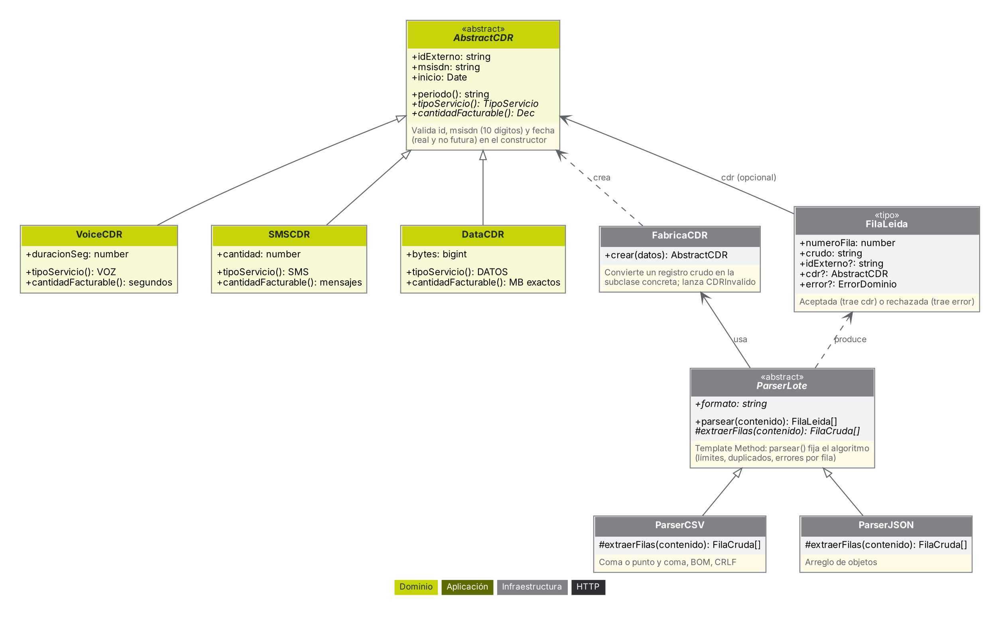

Ver el código Mermaid (editable; GitHub lo dibuja solo)

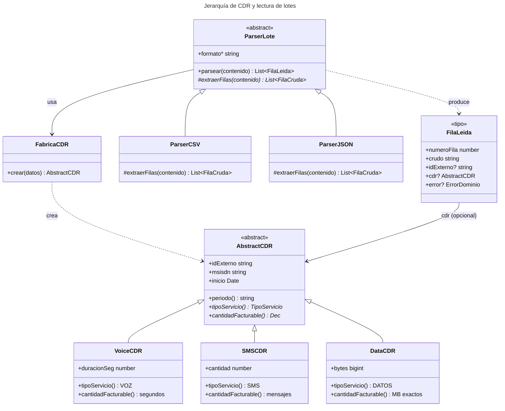

- **`AbstractCDR`** es una clase abstracta: concentra los datos y validaciones comunes y obliga a cada subtipo a
  declarar qué servicio es y cuánto consumió. TypeScript impide instanciarla (una prueba con `@ts-expect-error` lo demuestra).
- **Polimorfismo:** el motor de rating trabaja con `AbstractCDR` y nunca pregunta por el subtipo (`instanceof`).
- **Template Method:** `ParserLote.parsear()` fija el algoritmo (límites, duplicados, errores por fila) y cada formato
  solo implementa `extraerFilas()`. Agregar un formato nuevo no toca el algoritmo.

## 3. Estrategias de tarificación

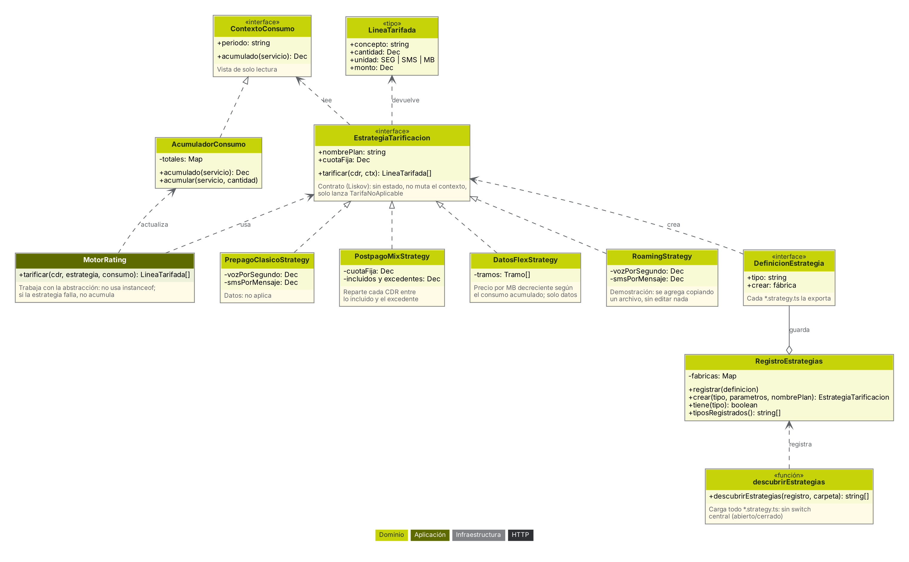

Ver el código Mermaid (editable; GitHub lo dibuja solo)

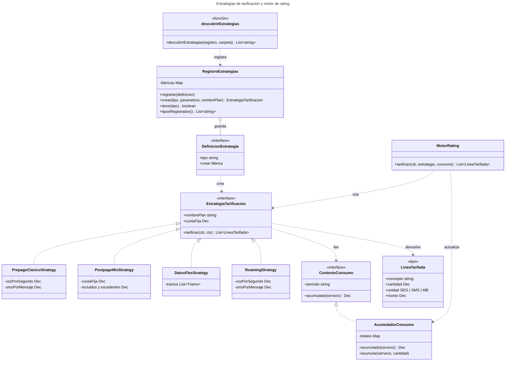

- **Strategy sin estado.** Una estrategia no guarda consumo: lo recibe en un `ContextoConsumo` de **solo lectura** y es
  el motor quien lo acumula. Así se resuelve la tensión entre «tarificar un CDR a la vez» y los planes cuyo precio
  depende de lo consumido antes (incluidos del postpago, tramos de Datos-Flex).
- **Un CDR puede producir varias líneas** (por ejemplo, un CDR de datos que cruza dos tramos de precio).
- **Abierto/cerrado.** Agregar un plan con lógica nueva es **crear un archivo** `*.strategy.ts`: el descubrimiento lo
  registra solo, sin `switch` central ni editar clases existentes. Un plan con la misma lógica pero otras tarifas se
  crea solo con datos (`POST /api/planes`).
- **Liskov comprobable.** [`contrato.test.ts`](../test/unit/dominio/estrategias/contrato.test.ts) ejecuta las mismas
  verificaciones sobre **todas** las estrategias: sin estado, sin mutar el contexto, solo `TarifaNoAplicable` como
  error, y la suma de las líneas coincide exactamente con la cantidad del CDR.

## 4. Persistencia: Repository y Unidad de Trabajo

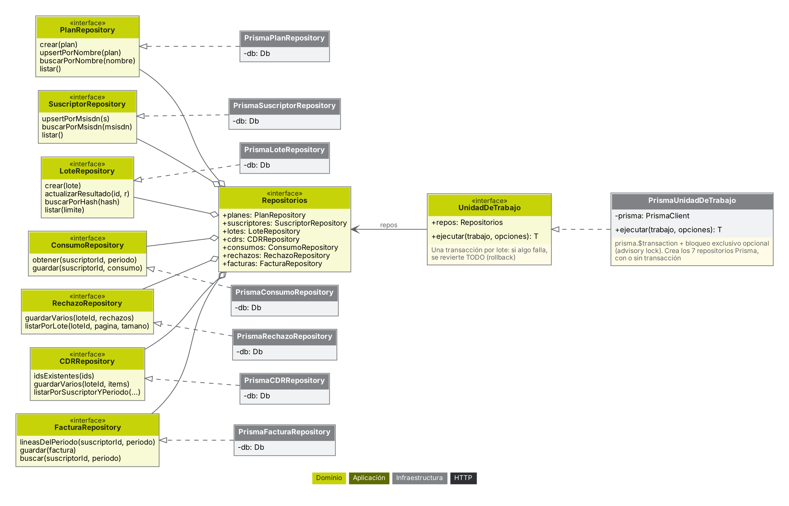

Ver el código Mermaid (editable; GitHub lo dibuja solo)

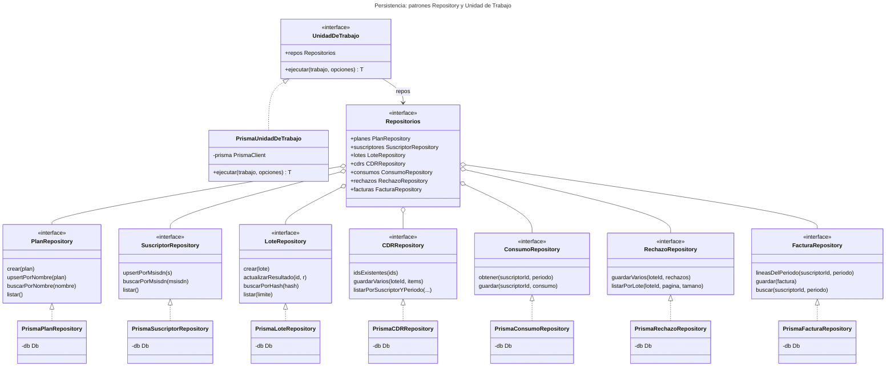

- El dominio define **solo interfaces** (siete repositorios pequeños, uno por agregado). Prisma queda aislado en
  `infrastructure`. El seed y varias pruebas usan repositorios **en memoria** que cumplen las mismas interfaces.
- **Unidad de Trabajo:** `ejecutar()` agrupa varias operaciones en **una transacción**. Si algo falla, se revierte todo:
  es el *rollback* del lote completo. Con `exclusivo: true` toma un bloqueo consultivo de PostgreSQL que serializa las
  ingestas, para que dos lotes simultáneos del mismo suscriptor no pierdan consumo acumulado.

## 5. Errores del dominio

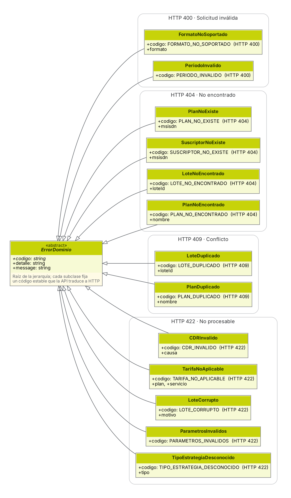

Ver el código Mermaid (editable; GitHub lo dibuja solo)

```mermaid
---
title: "Jerarquía de errores del dominio y su estado HTTP"
---
classDiagram
  direction TB
  classDef dominio fill:#F7FAD5,stroke:#8A9400,color:#1E2A00
  classDef aplicacion fill:#EEF1D9,stroke:#5E6B00,color:#1E2A00
  classDef infra fill:#F1F2F3,stroke:#808286,color:#2E3033
  classDef http fill:#E8E9EA,stroke:#2E3033,color:#2E3033
  classDef externo fill:#FFFFFF,stroke:#808286,color:#2E3033,stroke-dasharray:4
  class ErrorDominio:::dominio {
    <<abstract>>
    +codigo* string
    +detalle string
    +message string
  }
  class CDRInvalido:::dominio {
    +codigo CDR_INVALIDO  (HTTP 422)
    +causa
  }
  class PlanNoExiste:::dominio {
    +codigo PLAN_NO_EXISTE  (HTTP 404)
    +msisdn
  }
  class TarifaNoAplicable:::dominio {
    +codigo TARIFA_NO_APLICABLE  (HTTP 422)
    +plan, +servicio
  }
  class SuscriptorNoExiste:::dominio {
    +codigo SUSCRIPTOR_NO_EXISTE  (HTTP 404)
    +msisdn
  }
  class LoteNoEncontrado:::dominio {
    +codigo LOTE_NO_ENCONTRADO  (HTTP 404)
    +loteId
  }
  class LoteDuplicado:::dominio {
    +codigo LOTE_DUPLICADO  (HTTP 409)
    +loteId
  }
  class PlanDuplicado:::dominio {
    +codigo PLAN_DUPLICADO  (HTTP 409)
    +nombre
  }
  class PlanNoEncontrado:::dominio {
    +codigo PLAN_NO_ENCONTRADO  (HTTP 404)
    +nombre
  }
  class LoteCorrupto:::dominio {
    +codigo LOTE_CORRUPTO  (HTTP 422)
    +motivo
  }
  class ParametrosInvalidos:::dominio {
    +codigo PARAMETROS_INVALIDOS  (HTTP 422)
  }
  class TipoEstrategiaDesconocido:::dominio {
    +codigo TIPO_ESTRATEGIA_DESCONOCIDO  (HTTP 422)
    +tipo
  }
  class FormatoNoSoportado:::dominio {
    +codigo FORMATO_NO_SOPORTADO  (HTTP 400)
    +formato
  }
  class PeriodoInvalido:::dominio {
    +codigo PERIODO_INVALIDO  (HTTP 400)
  }
  ErrorDominio <|-- CDRInvalido
  ErrorDominio <|-- PlanNoExiste
  ErrorDominio <|-- TarifaNoAplicable
  ErrorDominio <|-- SuscriptorNoExiste
  ErrorDominio <|-- LoteNoEncontrado
  ErrorDominio <|-- LoteDuplicado
  ErrorDominio <|-- PlanDuplicado
  ErrorDominio <|-- PlanNoEncontrado
  ErrorDominio <|-- LoteCorrupto
  ErrorDominio <|-- ParametrosInvalidos
  ErrorDominio <|-- TipoEstrategiaDesconocido
  ErrorDominio <|-- FormatoNoSoportado
  ErrorDominio <|-- PeriodoInvalido
```

Todos heredan de `ErrorDominio` y fijan un **código estable**. La capa HTTP los traduce con una tabla
([`src/http/errores.ts`](../src/http/errores.ts)); un error nuevo requiere una sola línea. Los errores **inesperados**
responden 500 con un mensaje genérico y **no exponen** detalles internos (una prueba lo verifica).

## 6. Secuencia: procesar un lote

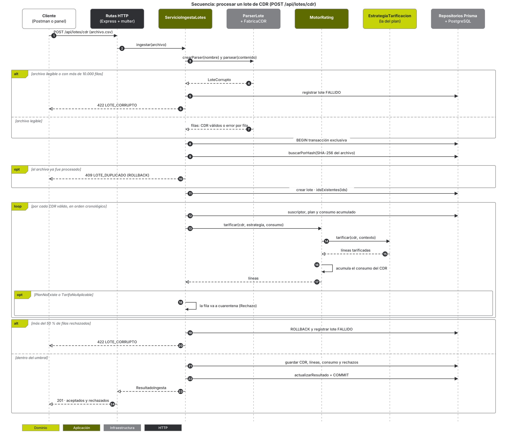

Ver el código Mermaid (editable; GitHub lo dibuja solo)

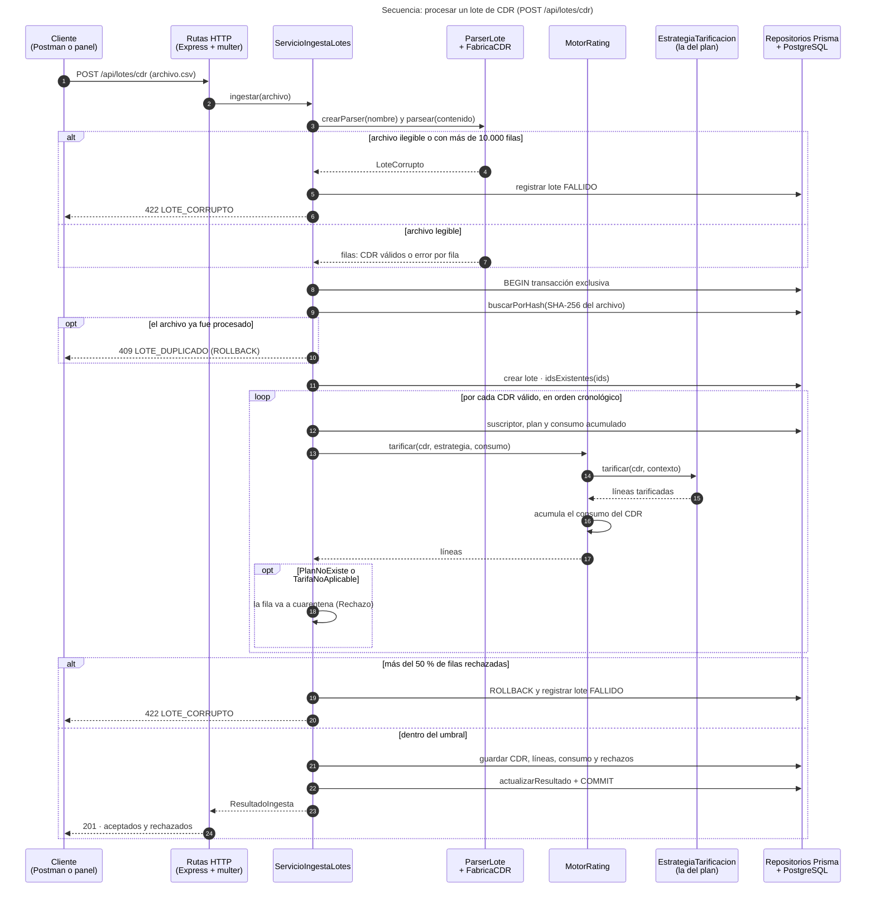

Puntos clave del flujo:
- **Pasos 3 a 7:** el archivo se lee *antes* de abrir la transacción. Un archivo ilegible deja constancia de un lote
  `FALLIDO` y responde 422.
- **Pasos 8 a 10:** dentro de una transacción exclusiva se comprueba la **idempotencia** por hash SHA-256 del contenido.
- **Pasos 12 a 18 (bucle):** los CDR se tarifican en **orden cronológico** (el consumo acumulado depende del orden).
  Si la estrategia lanza `TarifaNoAplicable`, el consumo **no** se acumula y la fila va a cuarentena.
- **Pasos 19 a 24:** si más del 50 % de las filas se rechazan, se revierte todo; si no, se guarda y se confirma.

## 7. Secuencia: consultar una factura

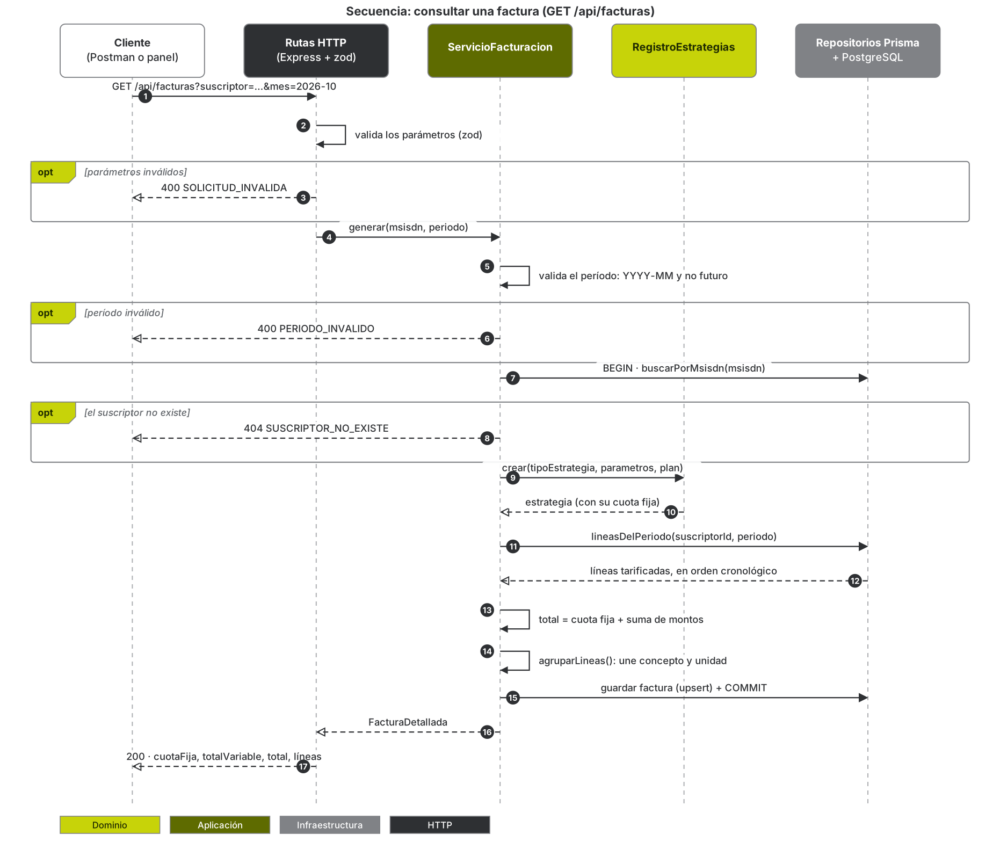

Ver el código Mermaid (editable; GitHub lo dibuja solo)

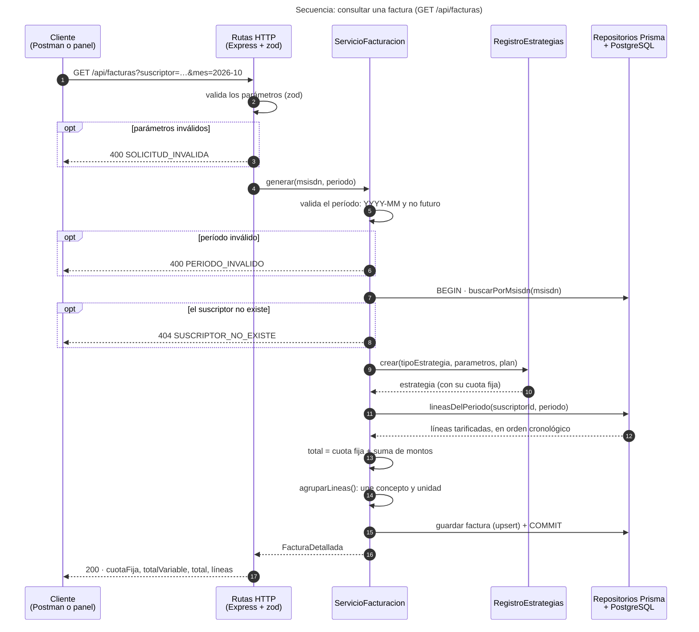

Factura = **cuota fija del plan** (una sola vez) + **suma de las líneas** tarificadas del período. Es **idempotente**:
consultarla varias veces actualiza el mismo registro. Los períodos son meses calendario en **hora de Bogotá**.

## 8. Modelo de datos

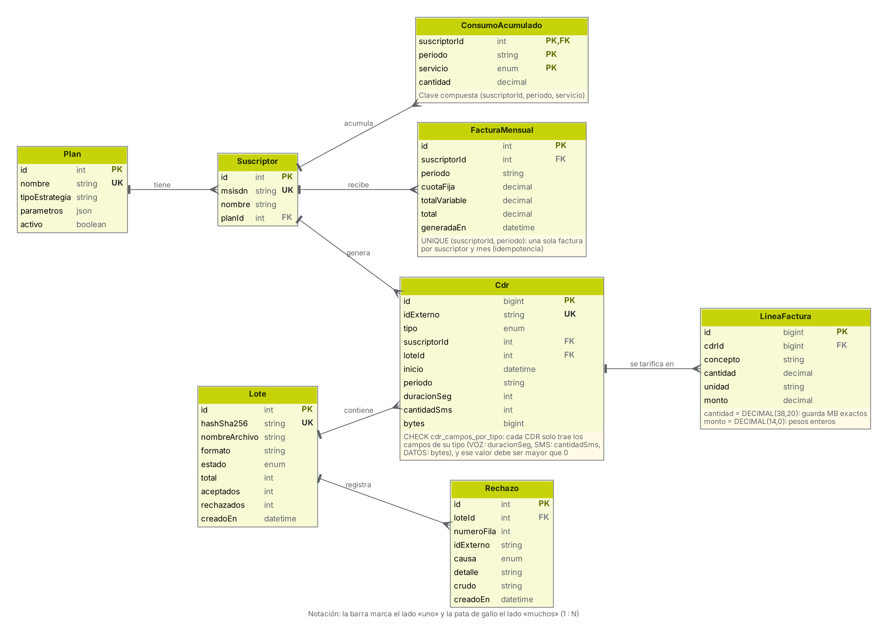

Ver el código Mermaid (editable; GitHub lo dibuja solo)

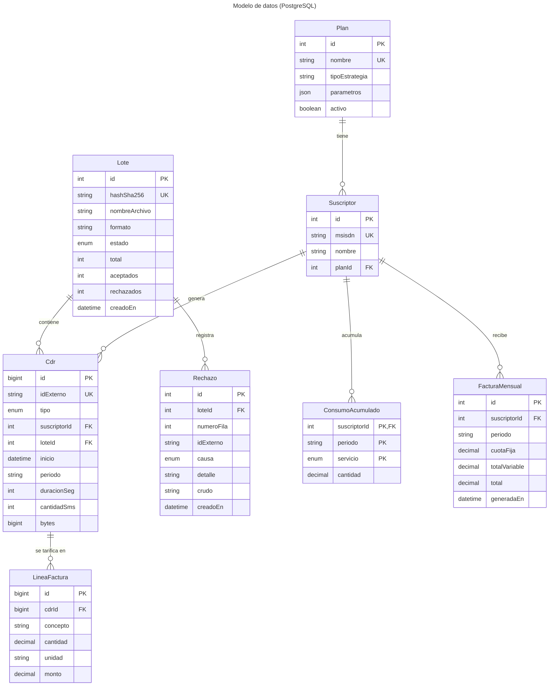

- Una **restricción `CHECK`** garantiza que cada CDR solo traiga los campos de su tipo. Exige `IS NOT NULL` de forma
  explícita, porque en SQL `NULL > 0` no es falso sino «desconocido» y un `CHECK` solo rechaza lo falso (defecto que
  encontró una prueba de integración; ver el [informe de calidad](informe-calidad.md)).
- Las cantidades usan `DECIMAL(38,20)`: un byte equivale **exactamente** a 9,5367431640625×10⁻⁷ MB (20 decimales) y con
  menos escala se perdería precisión al acumular.
- `FacturaMensual` es única por `(suscriptor, período)`, lo que da la idempotencia de la factura.

## 9. Patrones de diseño y principios SOLID

| Patrón o principio | Dónde está | Evidencia |
| --- | --- | --- |
| Herencia, clase abstracta y polimorfismo | `AbstractCDR` y sus tres subclases; `MotorRating` | [`cdr.test.ts`](../test/unit/dominio/cdr.test.ts), [`motor.test.ts`](../test/unit/application/motor.test.ts) |
| **Strategy** | `EstrategiaTarificacion` y los planes | [`planes.test.ts`](../test/unit/dominio/estrategias/planes.test.ts) |
| **Factory / Registro** | `FabricaCDR`, `RegistroEstrategias` | [`fabricaCDR.test.ts`](../test/unit/infraestructura/fabricaCDR.test.ts), [`registro.test.ts`](../test/unit/dominio/estrategias/registro.test.ts) |
| **Template Method** | `ParserLote` | [`parsers.test.ts`](../test/unit/infraestructura/parsers.test.ts) |
| **Repository** | `src/domain/repositorios` + `Prisma*Repository` | [`repositorios.test.ts`](../test/integration/repositorios.test.ts) |
| **Unidad de Trabajo** | `UnidadDeTrabajo` / `PrismaUnidadDeTrabajo` | pruebas de *rollback* y de concurrencia |
| Inyección de dependencias | `src/composicion.ts` | [`api.test.ts`](../test/unit/http/api.test.ts) (servicios simulados) |
| Excepciones propias | jerarquía de `ErrorDominio` | [`errores.test.ts`](../test/unit/dominio/errores.test.ts) |
| **S**: responsabilidad única | `MotorRating` tarifica, `ServicioIngestaLotes` orquesta, los parsers leen | cada clase tiene su propio archivo de pruebas |
| **O**: abierto/cerrado | plan nuevo = un archivo; formato nuevo = un parser; error nuevo = una línea | [`registro.test.ts`](../test/unit/dominio/estrategias/registro.test.ts) (demostración de Roaming) |
| **L**: sustitución de Liskov | contrato común de todas las estrategias | [`contrato.test.ts`](../test/unit/dominio/estrategias/contrato.test.ts) |
| **I**: segregación de interfaces | siete repositorios pequeños; la capa HTTP recibe `Pick<>` de los servicios | [`dependencias.ts`](../src/http/dependencias.ts) |
| **D**: inversión de dependencias | el dominio define interfaces y la infraestructura las implementa | [`arquitectura.test.ts`](../test/unit/arquitectura.test.ts) |

## 10. Decisiones de diseño y sus compromisos

| Decisión | Por qué | Compromiso |
| --- | --- | --- |
| **TypeScript estricto** | Clases abstractas e interfaces reales; el compilador actúa como segunda revisión | Configuración inicial algo mayor |
| **`Decimal`, nunca `number`, para dinero** | `0.1 + 0.2 !== 0.3` en coma flotante; la facturación no puede tolerarlo | Hay que convertir en los bordes (JSON usa texto) |
| **Bytes como `bigint`** | Coincide con el `BigInt` de la base de datos y no pierde precisión | Requiere cuidado al serializar |
| **Una transacción por lote** | O se guarda completo o no se guarda nada | Un lote muy grande mantiene la transacción abierta (por eso el máximo de 10.000 registros) |
| **Umbral del 50 % de rechazos** | Con más de la mitad de filas malas el archivo es sospechoso | El valor es configurable, pero arbitrario |
| **Constancia del lote `FALLIDO` fuera de la transacción** | La transacción revertida no puede dejar registro de sí misma | Un segundo paso, que reutiliza el registro en los reintentos |
| **Idempotencia por hash del contenido** | Detecta el mismo archivo aunque cambie de nombre | Un cambio mínimo en el archivo lo hace «distinto» |
| **Tarificar en orden cronológico** | Los incluidos y los tramos dependen del orden | Los CDR que llegan tarde en otro lote usan el acumulado vigente (ver límites) |
| **`CHECK` en la base además de la validación en código** | Defensa en profundidad: la base protege sus datos aunque falle el código | Una regla en dos lugares |
| **Facturación sin bloqueo exclusivo** | Se probó que no aportaba nada y solo hacía esperar las consultas durante una ingesta | Ninguno comprobado |
| **Errores en dos niveles** | Una fila mala es un problema de datos; un plan mal configurado es un problema del sistema y revierte todo | Más tipos de error |

## 11. Limitaciones conocidas y trabajo futuro

- **CDR que llegan tarde:** si un CDR de una fecha anterior llega en un lote posterior, se tarifica con el acumulado
  vigente; no se re-tarifica el período. Es una limitación asumida.
- **Un plan por suscriptor y período:** no se contempla el cambio de plan a mitad de mes.
- **Sin autenticación:** la API está abierta. Para exponerla en internet habría que agregar una clave de API o JWT.
- **Lectura en memoria:** el archivo se procesa completo en memoria (suficiente para el máximo de 10.000 registros);
  un volumen mayor pediría lectura en flujo.
- **Acoplamiento aceptado:** `ServicioIngestaLotes` usa directamente los lectores de `infrastructure` (la flecha
  discontinua del diagrama 1). Con más formatos o un uso más amplio se invertiría con una interfaz.
- **Alcance fuera del proyecto:** IVA, cobro real, aplicación móvil nativa y despliegue en la nube.
- **Trabajo futuro:** panel web completo con PWA (la API ya expone todo lo que necesita), autenticación y despliegue
  (frontend en Vercel y backend en un servidor persistente).

## Cómo editar los diagramas

El texto Mermaid de cada diagrama está en [`diagramas/*.mmd`](diagramas). Para modificarlo: abre <https://mermaid.live>,
pega el contenido, ajusta y exporta. Las imágenes `.png` y `.svg` incluidas se generaron a partir de **la misma
descripción** que los `.mmd`, por lo que muestran el mismo contenido (el estilo gráfico puede variar ligeramente).
